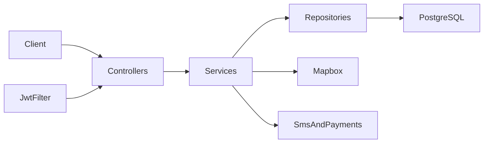

# RideConnect

RideConnect is a digital mobility, logistics, and finance API for Rwanda. The service is a Spring Boot REST application, artifact `rideconnect-backend` version `1.0.0`, in the base package `app.io.rideconnect`.

Clients send JSON to `/api/v1`. Responses are wrapped in `ApiResponse`. The process listens on port **9090**.

## Architecture

A request passes through a stateless JWT filter, a REST controller, a service, and a Spring Data JPA repository. Hibernate maps entities to PostgreSQL and updates the schema on startup (`spring.jpa.hibernate.ddl-auto=update`). There is no Flyway or Liquibase migration set.



`RideConnectApplication` enables caching, async work, and scheduling. On startup, `RoleSeeder` inserts any missing role rows. Caches for users, drivers, rides, promotions, and hotspots are in-process.

Ride flow:

1. A passenger creates a ride (`POST /api/v1/rides`). Fare calculation uses vehicle type, distance, surge, and an optional promotion.
2. A nearby driver accepts the ride. Matching searches within the configured radius (default 10 km).
3. The driver starts the ride, posts GPS points to `/api/v1/tracking`, and completes it.
4. Either party can cancel. A passenger can raise SOS on an active ride.
5. Payment (cash, mobile money, or card) marks the ride paid and writes a driver-finance row after commission.
6. A rating updates the driver's average and tier.

## Tech stack

| Piece | Choice |
| --- | --- |
| Runtime | Java 21, Spring Boot 3.2.0 |
| Web | `spring-boot-starter-web`, validation, actuator |
| Persistence | Spring Data JPA, PostgreSQL, HikariCP (max pool 10) |
| Security | Spring Security, stateless sessions, BCrypt strength 12, jjwt 0.12.3 |
| Mapping | MapStruct 1.5.5, Lombok |
| API docs | springdoc OpenAPI 2.1.0 |
| HTTP client | Spring WebClient (`spring-boot-starter-webflux` on the classpath) |
| Cache | Spring Cache, in-memory |
| Metrics | Actuator plus Micrometer Prometheus |
| Build | Maven. `Dockerfile` uses Temurin 21 |

Coordinates are `Double` latitude and longitude columns. Compose starts a PostGIS image so a spatial extension is available in the database container. The Java model does not use geometry types.

## Layout

```
src/main/java/app/io/rideconnect/
├── RideConnectApplication.java
├── controller/          REST resources under /api/v1
├── service/             interfaces
│   ├── impl/            @Service implementations
│   └── security/        CustomUserDetailsService
├── repository/          Spring Data repositories
├── entity/              JPA entities, enums, security tokens
├── dto/                 request and response objects
├── mapper/              MapStruct mappers
├── config/              security, JPA, cache, OpenAPI, fare, maps, SMS, payments
├── filters/             JwtAuthenticationFilter
├── exception/           GlobalExceptionHandler and domain errors
├── seeder/              RoleSeeder
├── util/                constants, files, random values, role mapping
└── urtils/secutiry/     JwtUtil (package name is misspelled)
```

Tests live in `src/test/java/app/io/rideconnect/RideConnectApplicationTests.java` (`contextLoads` only). The image build skips tests.

## Domain

Identifiers are UUID strings.

| Area | Main types |
| --- | --- |
| Identity | `User`, `Role` (`PASSENGER`, `DRIVER`, `ADMIN`, `BUSINESS`), `UserLocation` |
| Trips | `Ride` (`PASSENGER`, `GOODS_DELIVERY`, `CARPOOL`), `RideTracking`, `RideRating`, `Delivery` |
| Drivers | `DriverProfile` (vehicle `MOTORCYCLE`, `CAR`, `VAN`), `DriverFinance` |
| Commercial | `Promotion`, `BusinessProfile`, `Hotspot` |
| Tokens | `RefreshToken`, `PasswordResetToken`, `EmailVerificationToken` |

Relationships that the services use:

- A user has many roles, locations, rides as passenger, and rides as driver.
- A user may have one driver profile and one business profile.
- A ride has tracking points, one rating, and an optional delivery.
- A driver profile has finance ledger rows. A ledger row may point at a ride.

Default fares are in RWF, from `application.properties`:

| Vehicle | Base | Per km |
| --- | --- | --- |
| Motorcycle | 500 | 200 |
| Car | 1000 | 400 |
| Van | 1500 | 600 |

Commission rate is `0.15`. Surge multiplier is `1.5`. Ride request timeout is 300 seconds.

## API

Every controller is a `@RestController`. Interactive contracts are at [http://localhost:9090/swagger-ui.html](http://localhost:9090/swagger-ui.html). The OpenAPI document is at `/v3/api-docs`.

| Prefix | Controller | What it covers |
| --- | --- | --- |
| `/api/v1/auth` | `AuthController` | Login, register, logout, refresh, reset password, change password |
| `/api/v1/users` | `UserController` | User CRUD, lookup by email, phone, or role, location update |
| `/api/v1/rides` | `RideController` | Create, accept, start, complete, cancel, status, fare, SOS, admin analytics |
| `/api/v1/tracking` | `RideTrackingController` | Append and read GPS points for a ride |
| `/api/v1/ratings` | `RideRatingController` | Create a rating and read driver or passenger averages |
| `/api/v1/drivers` | `DriverProfileController` | Profile, availability, nearby search, verify, tier, admin analytics |
| `/api/v1/finances` | `DriverFinanceController` | Ledger entries and a per-driver summary |
| `/api/v1/deliveries` | `DeliveryController` | Delivery on a ride, proof, completion, pending list |
| `/api/v1/payments` | `PaymentController` | Mobile money, card, cash, refund, status, provider callback |
| `/api/v1/promotions` | `PromotionController` | Create, lookup, list active, apply, delete |
| `/api/v1/businesses` | `BusinessProfileController` | Business profile CRUD and search |
| `/api/v1/fare` | `FareController` | Calculate and estimate a fare |
| `/api/v1/geocoding` | `GeocodingController` | Address, coordinates, distance, duration |
| `/api/v1/hotspots` | `HotspotController` | Nearby and top demand hotspots |
| `/api/v1/notifications` | `NotificationController` | Admin test push, test SMS, and broadcast |
| `/api/v1/analytics` | `AnalyticsController` | Admin rides, drivers, revenue, hourly demand, geographic, dashboard |
| `/api/v1/reports` | `ReportController` | Ride export, driver finance report, monthly performance |
| `/api/v1/admin` | `AdminController` | Dashboard stats, user status, expire promotions, system health |

Actuator exposes `health`, `info`, `metrics`, and `prometheus` under `/actuator`.

## Security

Sessions are stateless. CSRF is disabled. CORS allows every origin, method, and header, with credentials off.

Public routes:

- `/api/v1/auth/**`
- Swagger and OpenAPI (`/swagger-ui/**`, `/v3/api-docs/**`, `/webjars/**`)
- `/actuator/**`
- `POST /api/v1/users`
- `OPTIONS` on every path

Every other route requires `Authorization: Bearer <access-token>`.

Login loads the account by email through `CustomUserDetailsService`. Inactive accounts are rejected. Registration requires a password of at least 8 characters with one digit, one lowercase letter, one uppercase letter, and one character from `@#$%^&+=`.

`JwtUtil` signs HS256 tokens. The access token subject is the email and lives 24 hours (`86400000` ms). The refresh token adds claim `type=refresh` and lives 7 days (`604800000` ms). `POST /api/v1/auth/refresh-token` issues a new pair when the refresh token is valid and the user is active. Logout clears the security context only. The access token stays valid until it expires. Refresh rows are not persisted on login.

`application.properties` references `jwt.secret=${JWT_SECRET}`. The `@Value` bindings in `JwtUtil` are commented out, so token signing uses the key compiled into that class. Set `JWT_SECRET` anyway: Spring resolves the placeholder while loading properties.

`/api/v1/admin/**` requires role `ADMIN`. Method security (`@PreAuthorize`) protects admin, driver, and business operations on the controllers that declare it. Matchers for `/api/v1/driver/**`, `/api/v1/passenger/**`, and `/api/v1/business/**` do not cover the live prefixes `/api/v1/drivers` and `/api/v1/businesses`.

## Integrations

These calls are wired in configuration and services with the behavior currently in code:

- **Mapbox.** `GeocodingServiceImpl` requests `https://api.mapbox.com`. Reverse geocoding returns a coordinate string. Forward geocoding returns fixed Kigali coordinates (`-1.9403`, `29.8739`). Distance uses the Haversine formula. Duration assumes an average speed of 40 km/h.
- **Mobile money and cards.** `PaymentServiceImpl` builds a payment payload and marks the ride `COMPLETED`. The mobile-money method contains a TODO for a real MTN MoMo or Airtel Money client. Card handling follows the same simulated path.
- **SMS.** `NotificationServiceImpl.sendSMS` POSTs to `{sms.api-url}/send` with a bearer key and sender id `RideConnect`.
- **Firebase.** The Admin SDK is on the classpath. Push notification methods log the message. No `FirebaseApp` initialization runs.
- **Email.** Reset-password stores a token on the user. The mail send in `AuthServiceImpl` is commented out.
- **Hotspots.** `HotspotServiceImpl.analyzeAndUpdateHotspots` runs every hour (`0 0 * * * *`).
- **Tracking.** Location updates are REST `POST` and `GET`. There is no WebSocket endpoint.

## Configuration

Runtime settings are in [`src/main/resources/application.properties`](src/main/resources/application.properties). Maven profiles `dev` (default), `prod`, and `test` in [`pom.xml`](pom.xml) set `spring.profiles.active`. The repository has no `application-dev.yml`, `application-prod.yml`, or `application-test.yml`, so those profiles do not load a separate file.

Spring Boot maps environment variables onto properties. Values below override the file when set:

| Variable | Property | Role |
| --- | --- | --- |
| `SPRING_DATASOURCE_URL` | `spring.datasource.url` | JDBC URL. Local default in the file is `jdbc:postgresql://localhost:5432/rideconnect` |
| `SPRING_DATASOURCE_USERNAME` | `spring.datasource.username` | Database user |
| `SPRING_DATASOURCE_PASSWORD` | `spring.datasource.password` | Database password |
| `JWT_SECRET` | `jwt.secret` | Required placeholder. See Security |
| `MAPS_API_KEY` | `maps.api-key` | Mapbox token |
| `SMS_API_URL`, `SMS_API_KEY` | `sms.api-url`, `sms.api-key` | SMS provider |
| `MOBILE_MONEY_API_URL`, `MOBILE_MONEY_API_KEY`, `MOBILE_MONEY_CALLBACK_URL` | `mobile-money.*` | Payment provider. Default callback uses port 8080 |
| `FIREBASE_CREDENTIALS_PATH` | `firebase.credentials-path` | Defaults to `classpath:firebase-credentials.json` |

Keep real passwords and API keys out of git. The properties file in the repo is for local development. Prefer environment variables in any shared or deployed environment.

Fare, commission, surge, search radius, and ride timeout are the `app.*` keys in the same file. Logging writes to `logs/rideconnect.log`. The debug logger name in that file is `com.rideconnect`. The code package is `app.io.rideconnect`.

## Run locally

Requirements: JDK 21, Maven, and PostgreSQL with a database named `rideconnect`.

1. Point `spring.datasource.url`, `spring.datasource.username`, and `spring.datasource.password` at that database, or export `SPRING_DATASOURCE_URL`, `SPRING_DATASOURCE_USERNAME`, and `SPRING_DATASOURCE_PASSWORD`.
2. Export `JWT_SECRET` to any non-empty value so property placeholder resolution succeeds.
3. Start the app:

```powershell
mvn spring-boot:run
```

The API is at `http://localhost:9090`. Health is at `http://localhost:9090/actuator/health`.

`mvn spring-boot:run -Pprod` or `-Ptest` only changes the active profile name. Behavior stays on `application.properties`.

## Docker

[`Dockerfile`](Dockerfile) is a multi-stage build. The builder image is `maven:3.9.6-eclipse-temurin-21-alpine` and runs `mvn clean package -DskipTests`. The runtime image is `eclipse-temurin:21-jre-alpine`. The process runs as non-root user `springuser` and exposes port 9090. The runtime image does not include `wget`. Compose healthchecks call `wget` against `/actuator/health`, so Compose can mark the app unhealthy while the process is up. Check `http://localhost:9090/actuator/health` directly.

[`compose.dev.yml`](compose.dev.yml) builds that Dockerfile and starts PostGIS (`postgis/postgis:16-3.4-alpine`). Postgres is published on host port **9000**. The app is published on **9090**.

[`compose.yml`](compose.yml) uses the same database service and pulls `ghcr.io/echo-sols-ltd/rideconnect-backend:latest` for the app.

Both files read `.env` and mount `./docker/db-init` into the database entrypoint. That directory is not in the repository. Hibernate creates the tables. `.env` is gitignored. Copy the example and edit the placeholders:

```powershell
copy .env.example .env
docker compose -f compose.dev.yml up --build
```

To run the published image after the registry pipeline has pushed it:

```powershell
docker compose -f compose.yml up
```

Inside Compose, the app reaches Postgres at host `db`, port `5432`. The JDBC URL in `.env.example` is `jdbc:postgresql://db:5432/rideconnect`. `POSTGRES_DB`, `SPRING_DATASOURCE_USERNAME`, and `SPRING_DATASOURCE_PASSWORD` need to match the database user and password.

## Container registry

[`.github/workflows/docker-publish.yml`](.github/workflows/docker-publish.yml) builds this `Dockerfile` and pushes to GitHub Container Registry.

The workflow runs when:

- a push to `main` changes `src/**`, `pom.xml`, `Dockerfile`, or the workflow file
- a tag matching `v*.*.*` is pushed (path filters apply to branch pushes only)
- someone starts it manually with **Run workflow**

The job checks out the repo, logs in to `ghcr.io` with `GITHUB_TOKEN`, and pushes:

`ghcr.io/<repository owner>/rideconnect-backend`

For this remote that image is `ghcr.io/echo-sols-ltd/rideconnect-backend`. `docker/metadata-action` lowercases the owner. Tags:

| Tag | When |
| --- | --- |
| `latest` | Push to the default branch |
| `sha-<commit>` | Every publish |
| `1.2.3`, `1.2`, `1` | Tag `v1.2.3` |

A private repository's package stays private until you change visibility under the package settings on GitHub. Pulling a private image needs a GitHub personal access token with `read:packages`:

```powershell
docker login ghcr.io -u YOUR_GITHUB_USERNAME
docker pull ghcr.io/echo-sols-ltd/rideconnect-backend:latest
```

Then start it with `docker compose -f compose.yml up` after `.env` is in place.
